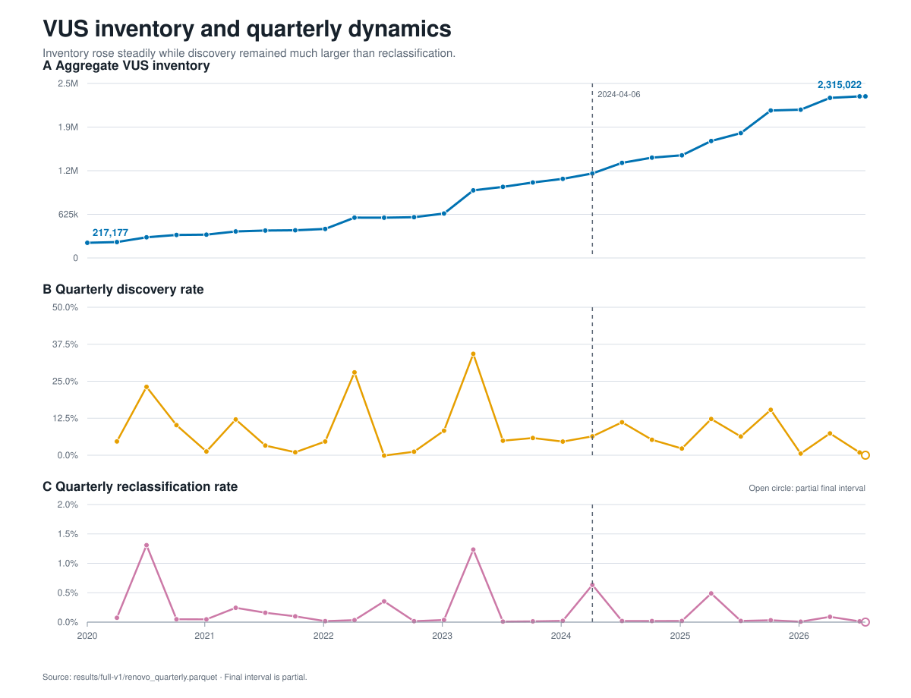
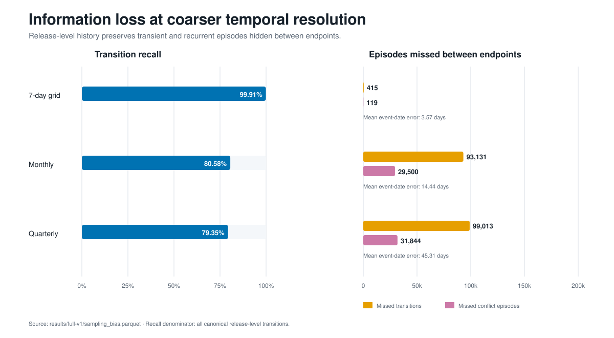
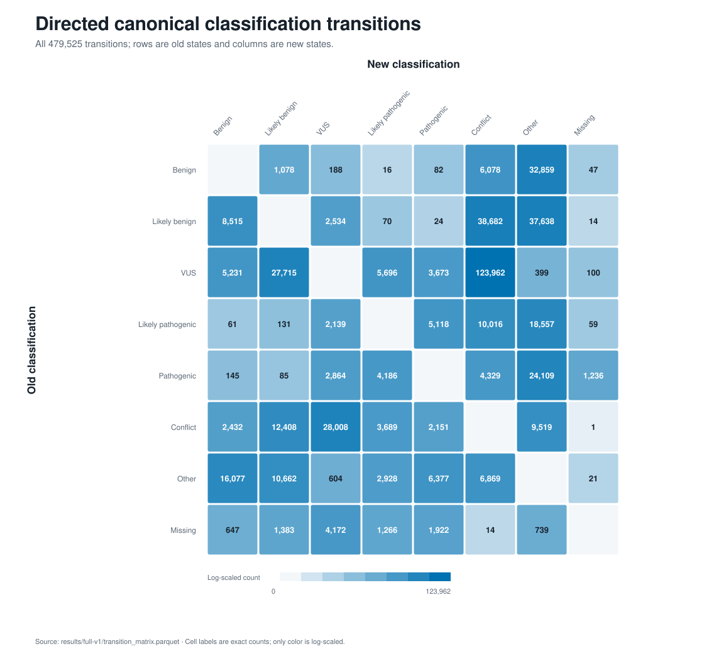
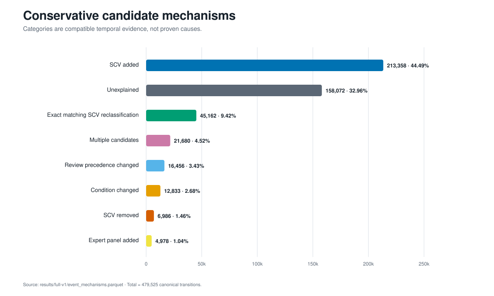
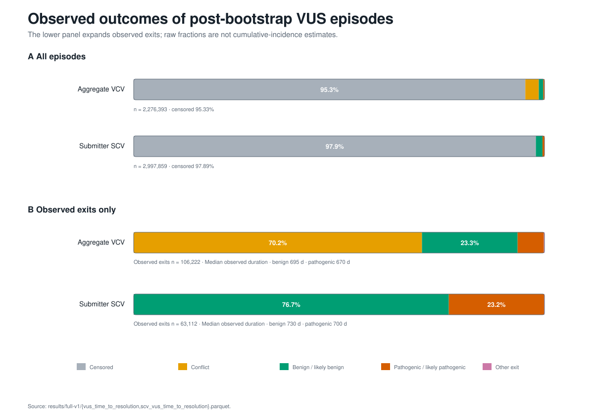

# ClinVar Classification History: Full-Backfill Final Report

> July baseline results. The [November full research extension](full-research-results.md) distinguishes net count recovery from matched-edge recall and adds reversible-batch, full-cohort and historical XML analyses that qualify these earlier results.


**Study window:** 6 January 2020–24 July 2026<br>
**Latest source releases:** GRCh38 VCF, 15 July 2026; submission summary,
July 2026<br>
**Status:** complete and independently re-audited on 25 July 2026

> This is a research-data report, not a clinical interpretation tool. Counts
> describe the retained ClinVar history under the normalization and sampling
> rules documented below.

## Executive summary

The completed backfill comprises 338 archived weekly GRCh38 VCF releases and
79 archived monthly submission-summary releases. All 417 manifest entries are
`completed` in the processing ledger. The retained dataset contains 4,439,827
current aggregate VCV records, 6,374,753 current SCV accessions, 23,623,719 VCV
events, and 20,519,761 SCV events.

The principal result is a widening imbalance between VUS accumulation and VUS
reclassification:

- aggregate VUS inventory increased from **217,177 to 2,315,022**, a net gain
  of 2,097,845 and a **10.66-fold** increase;
- across 26 complete quarters, mean quarterly reclassification was 0.195%,
  whereas mean quarterly discovery was 8.26%;
- after 6 April 2024, mean reclassification fell from 0.256% to 0.0790%, while
  discovery remained 6.82% per quarter;
- the ratio of summed net discovery to summed reclassification increased from
  34.20 before the split to **87.55** after it.

Release-level history also changes what can be observed. A regular 7-day grid
recovered 99.91% of the 479,525 canonical transitions. Monthly endpoints
recovered 80.58%, missing 93,131 transitions and 29,500 conflict episodes;
quarterly endpoints recovered 79.35%.

Conservative temporal attribution associated 44.49% of aggregate transitions
with an added SCV, while 32.96% remained unexplained. These are candidate
mechanisms, not causal assignments. VUS-episode outcomes were heavily
right-censored—95.33% for VCV episodes and 97.89% for SCV episodes—so the raw
fractions must not be interpreted as cumulative incidence.

## 1. Scope, provenance, and retained artifacts

The pipeline streamed 41.21 GiB of cumulative compressed source data and did
not retain raw archives. Deduplicating hard-linked latest-state/checkpoint
files, `data/full` occupies 829.5 MiB on disk; the seven result files occupy
28.6 MiB.

| Layer | Releases or rows | Coverage |
|---|---:|---|
| Weekly GRCh38 VCF | 338 releases | 6 Jan 2020–15 Jul 2026 |
| Monthly submission summary | 79 releases | Jan 2020–Jul 2026 |
| Processing ledger | 417 completed rows | Exact manifest/ledger key match |
| Latest VCV state | 4,439,827 rows | Unique `variation_id` |
| Latest SCV state | 6,374,753 rows | Unique `scv_accession` |
| VCV event store | 23,623,719 rows | 338 date partitions |
| SCV event store | 20,519,761 rows | 79 date partitions |

The monthly submission layer uses `source_month` as its longitudinal key and
the first day of that month as a nominal observation date. The VCF layer uses
the archived release date. The analytical horizon is 24 July 2026; the most
recent VCF available within that horizon is dated 15 July 2026.

### Canonical states and event semantics

Every source label is retained verbatim and also normalized to one of eight
states: `benign`, `likely_benign`, `vus`, `likely_pathogenic`, `pathogenic`,
`conflict`, `other`, or `missing`. A canonical transition requires the
normalized state to change. Raw-label-only changes remain in the event store
but are not counted as reclassifications.

The first snapshot in each layer is bootstrap inventory, not a known creation
date. Bootstrap SCV additions are excluded from attribution candidates, and
bootstrap VUS episodes are excluded from time-to-resolution output because
their true start predates observation.

### Quarterly definitions

For consecutive endpoints, the report follows the implemented RENOVO-style
formulas:

- reclassification rate = VUS exits divided by current-endpoint VUS count;
- discovery rate = net VUS change divided by current-endpoint VUS count;
- period-level discovery/reclassification ratio = summed net VUS change divided
  by summed VUS exits.

The final 6–24 July 2026 interval is partial. It contributes to the final
inventory and the all-interval exit total, but is excluded from complete-quarter
means and medians.

## 2. VUS inventory and quarterly dynamics



**Figure 1.** Aggregate VUS inventory and separate, aligned panels for quarterly
discovery and reclassification. The dashed line marks 6 April 2024; open final
markers identify the partial interval. One complete quarter, April–July 2022,
had a small negative net discovery rate (-0.123%).

Across the full window, VUS inventory increased by 2,097,845. The
consecutive-snapshot formula counted 41,673 VUS exits across all 27 intervals.
Among the 26 complete quarters, rates were dominated by a few batch-like
spikes: the overall median reclassification rate was 0.0354%, far below the
0.195% mean.

| Period | Complete quarters | Mean reclassification | Median reclassification | Mean discovery | Net discovery / reclassification |
|---|---:|---:|---:|---:|---:|
| 6 Jan 2020–6 Apr 2024 | 17 | 0.256% | 0.0488% | 9.03% | 34.20 |
| 6 Apr 2024–6 Jul 2026 | 9 | 0.0790% | 0.0203% | 6.82% | 87.55 |
| All complete quarters | 26 | 0.195% | 0.0354% | 8.26% | 50.35 |

The post-April-2024 mean reclassification rate was about 69% lower than in the
earlier project window. Discovery also slowed, but remained roughly 86 times
the post-split mean reclassification rate and produced a summed-flow ratio of
87.55. The data therefore support continued rapid VUS accumulation without a
commensurate increase in endpoint-observed resolution.

### Context relative to Bonetti et al.

[Bonetti et al. (2024)](https://doi.org/10.1186/s12967-024-05508-w) reported a
0.42% mean quarterly reclassification rate, a 12.40% mean discovery rate, and a
29.76 discovery/reclassification ratio through March 2024. The closest project
window is not an exact replication: release selection, dates, GRCh38 VCF
coverage, canonical normalization, composite-label handling, and endpoints
differ. The direction agrees—discovery substantially exceeds
reclassification—but the absolute estimates are not interchangeable.

## 3. What higher temporal resolution adds



**Figure 2.** Endpoint-sampling performance against the complete release-level
canonical event log. Coarser grids lose recurrent/transient episodes and widen
event-date error.

| Cadence | Observed transitions | Recall | Missed transitions | Missed conflict episodes | Mean date error |
|---|---:|---:|---:|---:|---:|
| 7-day grid | 479,110 | 99.91% | 415 | 119 | 3.57 days |
| Monthly | 386,394 | 80.58% | 93,131 | 29,500 | 14.44 days |
| Quarterly | 380,512 | 79.35% | 99,013 | 31,844 | 45.31 days |

The release-level result is not merely a smoother curve. Monthly snapshots
missed 19.42% of observed canonical transition episodes and nearly 30,000
conflict episodes. Quarterly snapshots lost slightly more events and placed
observed event dates, on average, about 45 days from the release-level dates.

The 7-day grid is a regular endpoint grid rather than the event log itself;
therefore its 99.91% recall is high but not exactly 100%. “Recall” here means
recovery of recorded release-level transitions, not sensitivity to an
unobserved biological ground truth.

## 4. Directed transition patterns



**Figure 3.** Counts for all directed canonical state changes. Cell labels are
exact; logarithmic color scaling keeps rare and common transitions visible.

The largest single directed transition was `vus → conflict` (123,962 events,
25.85% of all canonical transitions). Direct VUS movement toward benign states
totaled 32,946 (`vus → benign` plus `vus → likely_benign`), while movement
toward pathogenic states totaled 9,369. These are transition episodes, not
unique variants: a record can move repeatedly or reverse direction over the
study window.

The matrix also shows substantial movement involving `other` and `conflict`.
Collapsing those states into a simple benign–VUS–pathogenic ordinal scale would
discard an important part of the observed history.

## 5. Conservative candidate mechanisms



**Figure 4.** Primary candidate mechanisms assigned by overlap between the VCV
transition interval and compatible SCV event intervals, with a maximum
observation-date lag of 35 days.

| Primary candidate mechanism | Count | Share |
|---|---:|---:|
| SCV added | 213,358 | 44.49% |
| Unexplained | 158,072 | 32.96% |
| Exact matching SCV reclassification | 45,162 | 9.42% |
| Multiple candidates | 21,680 | 4.52% |
| Review precedence changed | 16,456 | 3.43% |
| Condition changed | 12,833 | 2.68% |
| SCV removed | 6,986 | 1.46% |
| Expert panel added | 4,978 | 1.04% |

“Exact matching SCV reclassification” is deliberately specific: an SCV must
show the same old and new canonical states as the aggregate VCV event in a
compatible interval. It is therefore a lower-bound candidate and may miss
joint effects from several submissions. Conversely, temporal compatibility
does not prove causality. The 32.96% unexplained share is a concrete target for
follow-up with richer ClinVar records and submission metadata.

## 6. VUS episode outcomes



**Figure 5.** All post-bootstrap VUS episodes (top) and a magnified composition
of observed exits only (bottom). High right-censoring makes the lower panel
necessary for legibility.

| Layer and outcome | Episodes | Share of all episodes |
|---|---:|---:|
| VCV censored | 2,170,171 | 95.33% |
| VCV conflict | 74,543 | 3.27% |
| VCV benign/likely benign | 24,723 | 1.09% |
| VCV pathogenic/likely pathogenic | 6,785 | 0.30% |
| VCV other exit | 171 | 0.0075% |
| SCV censored | 2,934,747 | 97.89% |
| SCV benign/likely benign | 48,410 | 1.61% |
| SCV pathogenic/likely pathogenic | 14,648 | 0.49% |
| SCV other exit | 54 | 0.0018% |

The VCV table contains 2,276,393 episodes, of which 106,222 had an observed
exit. Among those exits, 70.2% ended in conflict, 23.3% in a benign state, and
6.39% in a pathogenic state. Median observed durations were 695 days for
benign outcomes and 670 days for pathogenic outcomes.

The SCV table contains 2,997,859 episodes and 63,112 observed exits. Among SCV
exits, 76.7% ended in a benign state and 23.2% in a pathogenic state; no SCV
conflict outcome is defined by the retained submission-level history. Median
observed durations were 730 and 700 days, respectively.

These raw fractions are descriptive outcomes under unequal follow-up. They are
not survival probabilities or cumulative-incidence estimates. Publication-grade
probability estimates require survival or competing-risk models using the
retained episode dates and stratification fields.

## 7. Independent verification

The final-report builder rereads the local manifest, DuckDB ledger, state/event
Parquets, and all seven result Parquets. It stops before rendering if any
invariant fails.

| Check | Fresh evidence | Result |
|---|---|---:|
| Manifest and ledger | 417 unique release keys in each; exact key/date match | Pass |
| Completion | 338 VCF + 79 SCV ledger rows are `completed` | Pass |
| Checksums | Computed MD5 present for 417/417; 362/362 available official MD5 values match | Pass |
| Latest-state keys | 4,439,827 unique VCV IDs; 6,374,753 unique SCV accessions | Pass |
| Canonical state domain | No latest-state classification outside the eight documented states | Pass |
| Event partitions | 338 VCV + 79 SCV partitions; every `observed_at` equals its partition date | Pass |
| Result readability | Seven expected Parquets present with required schemas | Pass |
| Cross-table total | Attribution, mechanism, transition-matrix, and all cadence denominators = 479,525 | Pass |
| VCV episodes | Unique `(variation_id, started_at)`; valid outcome, duration, and study-end bounds | Pass |
| SCV episodes | Unique `(scv_accession, started_at)`; valid outcome, duration, and study-end bounds | Pass |
| Figure determinism | Two consecutive generations produced byte-identical SVGs | Pass |
| Automated checks | 118 tests; Ruff lint and format checks | Pass |

The seven result artifacts audited were:

| Artifact | Rows |
|---|---:|
| `attributions.parquet` | 479,525 |
| `event_mechanisms.parquet` | 8 |
| `renovo_quarterly.parquet` | 27 |
| `sampling_bias.parquet` | 3 |
| `transition_matrix.parquet` | 56 |
| `vus_time_to_resolution.parquet` | 2,276,393 |
| `scv_vus_time_to_resolution.parquet` | 2,997,859 |

### Restart evidence

The recorded control invocation at `2026-07-25T17:17:58Z` skipped all 338
completed VCF releases and all 79 completed SCV releases, reused the manifest,
attributions, and RENOVO output, and ended successfully at
`2026-07-25T17:35:37Z`. In that invocation, the remaining five analytical
outputs were completed rather than logged as reused. A fresh offline audit now
confirms that all seven outputs are readable and satisfy their invariants; the
runner will therefore recognize each as a reusable Parquet checkpoint.

This distinction matters: the log proves complete ingestion-checkpoint reuse,
while the current artifact audit proves readiness of every analytical
checkpoint. It avoids overstating what the recorded run itself demonstrated.

## 8. Interpretation and limitations

1. **Coverage is not all of ClinVar.** The GRCh38 VCF contains variants with
   precise genomic coordinates and does not represent the complete ClinVar
   corpus.
2. **Time is interval-censored.** `observed_at` is a release date, not the
   biological or laboratory decision date. Monthly SCV dates are nominal
   source-month coordinates.
3. **Endpoint formulas are definition-sensitive.** The quarterly rates use the
   current VUS count as denominator to match the implemented comparison; other
   cohort definitions produce different absolute values.
4. **Batch effects affect means.** A small number of high-change quarters make
   mean rates substantially larger than medians.
5. **Attribution is evidentiary.** Interval overlap and label compatibility
   identify candidates, not causes.
6. **Episode fractions are censoring-sensitive.** Raw outcomes cannot substitute
   for survival or competing-risk inference.
7. **Aggregate and submitter layers answer different questions.** A VCV state
   reflects ClinVar aggregation rules; an SCV state reflects an individual
   submission. Their outcome distributions should not be compared as if they
   were identical units.

## 9. Reproducibility

Regenerate the independent audit summary and all five figures without network
access:

```bash
uv run python analysis/07_build_final_report.py \
  --data-root data/full \
  --results-root results/full-v1 \
  --figures-dir docs/figures/full-backfill
```

The command prints a JSON summary containing every headline value used above.
It writes figures only after the full audit succeeds.

Run the complete repository checks:

```bash
uv run pytest -q
uv run ruff check .
uv run ruff format --check .
```

Field-level definitions are in the [data dictionary](data-dictionary.md). The
executed Parquet outputs are under `results/full-v1`; generated data and result
tables remain git-ignored, while this report, the audit/generation code, tests,
and SVG figures are versioned.
