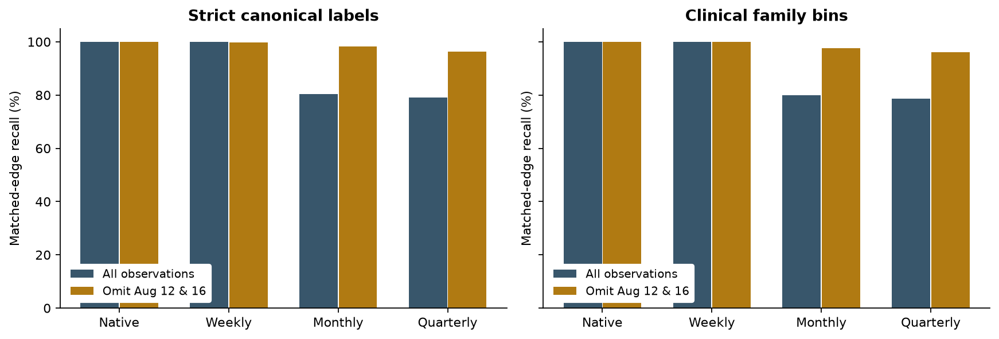
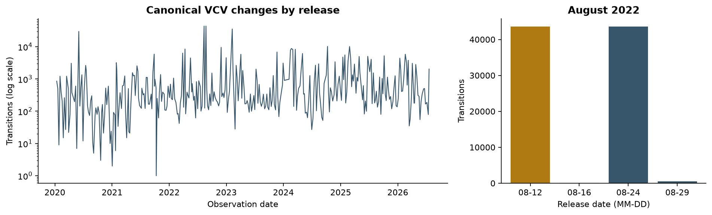
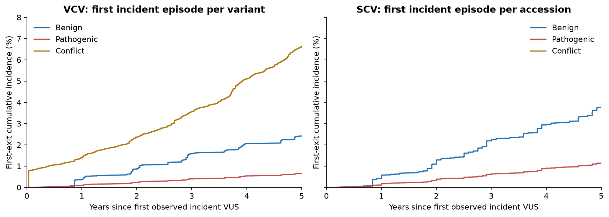
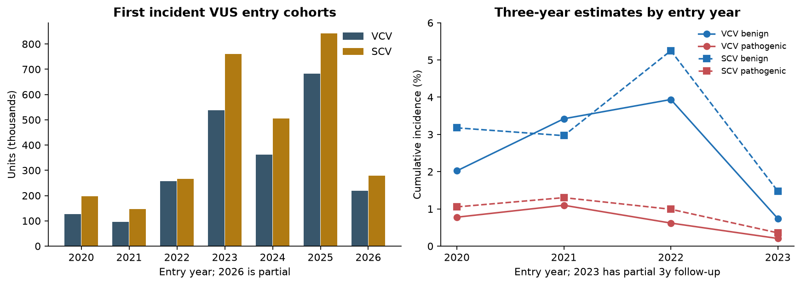
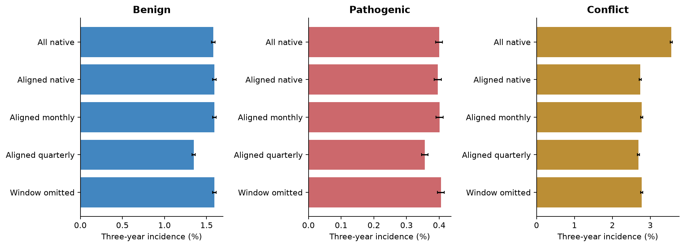

# Full ClinVar research extension: observation, endpoints and first VUS exits

Research run: 11 November 2026. The [July baseline report](full-backfill-results.md) provides the earlier source population and net-count analysis. The definitions below distinguish count recovery from matched-edge recall and use the extended source population.

The main finding is that the previously reported approximately 20% reduction in monthly transition counts is dominated by a short, highly reversible August 2022 batch. This changes the interpretation of the original result. It does not justify deleting those observations or declaring a database error. Full incident cohorts, cadence-aligned cohorts, dated XML and explicitly versioned XML provide complementary evidence.

## Analytical scope

| Analysis | Evidence | Limit |
|---|---|---|
| VUS duration and competing risks | All first incident VCV/SCV units; 92 prespecified executable analysis jobs; 1,000 variant-cluster bootstrap draws each; timing/removal/label/calendar sensitivities; aligned-cohort and recurrence analyses | Release-time descriptive estimates, with independent-censoring assumptions; no fitted biological interval-censoring likelihood |
| Unexplained transitions | 100 current records; 100 cases in each of two dated archives; 10 targeted three-version series; explicit population/selection/provenance | Automated evidence audit, not blinded curator validation or a population causal explanation rate |
| Safe updates | Managed semantic checkpoints and interruption/reuse tests; bounded real update; independently discovered July 20 release ingested into a separate research copy | The original backfill was audited, not downloaded again in full |
| Reproducibility | [Protocol](research-protocol.md), [literature matrix](literature-evidence.md), analysis tables, figures and source manifests | Observational research with explicit source, sampling and censoring limitations |

## Sources and independent reconstruction

The frozen baseline contains 417 releases: 338 VCF and 79 monthly submission summaries. Independent SQL reconstruction exactly matched all 2,276,393 VCV and 2,997,859 SCV exported episodes in that baseline, comparing unit, start, end, outcome and duration with multiset differences in both directions. This is an independent implementation check of the retained data, not an independent acquisition of every source.

Re-discovery within the same configured horizon found one additional available VCF release, 20 July 2026. The research copy therefore contains **418 sources: 339 VCF and 79 SCV summaries**. Its actual observation boundaries are 6 January 2020–20 July 2026 for VCV and nominal 1 January 2020–1 July 2026 for SCV. Administrative censoring uses each layer's actual last observation. The configured 24 July horizon is not treated as an observed release. The old exports had extended censoring nine VCV days and 23 nominal SCV days beyond their last source.

The research copy preserves the baseline and independently reconstructs 2,286,991 VCV and 2,997,859 SCV incident episodes. There are 2,280,091 distinct VCV first-incident units and 2,997,087 SCV accessions. Across all SCV events, 843 accessions have more than one VariationID. Excluding such identities removes 60 first-incident SCVs (63 episodes); the main SCV analysis has 2,997,027 accessions within 2,454,492 variant clusters. Including them is a sensitivity analysis. The VCF subset requires precise GRCh38 coordinates and does not cover the whole ClinVar archive.

Time zero is the first *observed incident* VUS episode, after excluding VUS inventory in the initial snapshot. A later return to VUS in a baseline-prevalent unit can enter this cohort. The estimand is therefore not first lifetime uncertainty. Entry metadata are the fields present on the structural state event, not continuously updated time-varying covariates.

## Endpoint policy changes what counts as a transition

Original normalization retains exact raw labels, maps the five ACMG classes individually and leaves unrecognized or mixed labels as `other`. The research family policy combines B/LB and P/LP, including the exact within-family composite labels, while retaining risk terms and mixed/unknown labels separately. It does not modify ingestion or assign an ordinal level to a composite label.

The extended history contains **481,556 canonical changes**. Among raw classification changes, 166,290 canonical changes stay in the same clinical family; conversely, 28 family changes were hidden inside canonical `other` to `other`. There are 315,294 family-level reference edges. Neither count alone measures a change in a laboratory's biological interpretation.

## Cadence: net counts versus matched recorded edges

A sampled B → P endpoint can summarize a recorded B → VUS → P path. It contributes one net edge but recovers neither original edge. We therefore report count recovery and matched-edge recall separately. A match requires the same variant, old state and new state within that sampling interval; at most one reference edge is credited per sampled edge. Unmatched sampled edges are synthesized summaries. Detection lag is computed only for matched edges. Absence is a separate state and additions/removals do not count as classification edges.

| Policy | Observation | Reference edges | Net edges | Count recovery % | Matched recall % | Synthesized edges |
| --- | --- | --- | --- | --- | --- | --- |
| strict | monthly | 481,556 | 388,425 | 80.660 | 80.489 | 823 |
| strict | quarterly | 481,556 | 382,543 | 79.439 | 79.041 | 1915 |
| family | monthly | 315,294 | 252,860 | 80.198 | 80.033 | 522 |
| family | quarterly | 315,294 | 249,350 | 79.085 | 78.754 | 1044 |
| strict | Window omitted; monthly | 394,880 | 388,425 | 98.365 | 98.176 | 749 |
| strict | Window omitted; quarterly | 394,880 | 382,543 | 96.876 | 96.410 | 1841 |
| family | Window omitted; monthly | 258,499 | 252,860 | 97.819 | 97.634 | 477 |
| family | Window omitted; quarterly | 258,499 | 249,350 | 96.461 | 96.074 | 999 |

These are observation-grid reconstructions from the same underlying event history. They describe recovery of recorded states, not accuracy against unobserved clinical decisions. Weekly/monthly/quarterly grids are anchored on the first VCF date and include the final source date; SCV monthly coordinates already have monthly cadence.

## A short reversible batch dominates the original count loss

The 12 August 2022 VCF observation contains 43,584 canonical changes; 43,303 (99.36%) have an exactly reversed next raw-label transition within 21 days. A second observation on 16 August preserves most of the changed state until the 24 August release. Omitting 12 August alone is consequently a weak negative control: unchanged state updates move into the next observation. The substantive sensitivity omits *both* 12 and 16 August observation boundaries, folds their updates forward and compares the final state on 24 August with the last retained state. It does not simply delete event rows and leave an inconsistent history.

Strict reference edges fall from 481,556 to 394,880; monthly net edges remain 388,425. Thus 86,676 of the original 93,131 missing net edges (93.07%) are associated with this window. Monthly count recovery becomes 98.365%, with matched recall 98.176%. Family-level monthly matched recall becomes 97.634%. The sensitivity is post hoc and localizes the result; it is not a corrected ground truth or a recommendation to discard real transitions.

## Full first-incident cumulative incidence

Aalen–Johansen estimation treats first benign, pathogenic, conflict and other exits as competing outcomes. Removal is censored at observed disappearance in the primary model. Events precede censored units at tied durations. Intervals below are pointwise 95% percentile intervals from 1,000 whole-VariationID bootstrap draws. Identical within-variant duration/outcome signatures are grouped; multinomial resampling of their frequencies is exactly equivalent to ordinary cluster resampling, retaining all SCVs within each sampled variant. It is not a sample of only 5,000 variants.

| Layer | Days | Units | At risk | Benign % (95% interval) | Pathogenic % (95% interval) | Conflict % (95% interval) |
| --- | --- | --- | --- | --- | --- | --- |
| VCV | 365 | 2,280,091 | 1,813,434 | 0.366 (0.357–0.374) | 0.088 (0.084–0.092) | 1.393 (1.378–1.408) |
| VCV | 730 | 2,280,091 | 1,209,181 | 0.869 (0.854–0.883) | 0.235 (0.227–0.243) | 2.365 (2.343–2.387) |
| VCV | 1095 | 2,280,091 | 878,703 | 1.581 (1.559–1.601) | 0.400 (0.389–0.410) | 3.555 (3.524–3.586) |
| VCV | 1825 | 2,280,091 | 164,665 | 2.417 (2.377–2.455) | 0.660 (0.637–0.682) | 6.646 (6.580–6.716) |
| SCV | 365 | 2,997,027 | 2,307,181 | 0.473 (0.465–0.483) | 0.141 (0.136–0.145) | 0.000 (0.000–0.000) |
| SCV | 730 | 2,997,027 | 1,686,796 | 1.136 (1.122–1.149) | 0.347 (0.339–0.355) | 0.000 (0.000–0.000) |
| SCV | 1095 | 2,997,027 | 1,171,182 | 2.192 (2.169–2.216) | 0.616 (0.603–0.628) | 0.000 (0.000–0.000) |
| SCV | 1825 | 2,997,027 | 269,214 | 3.761 (3.718–3.805) | 1.141 (1.117–1.166) | 0.000 (0.000–0.000) |

The independently implemented statsmodels cumulative-incidence estimator matched the complete VCV and SCV point curves to maximum absolute differences below 7e-17. Analytic/tied-time tests and a two-SCV-per-variant bootstrap control separately verify the implementation. These comparisons verify the estimator on the selected observations, not the independent-censoring assumption.

Pooled five-year estimates rely on early cohorts: the VCV risk set declines to 164,665, and SCV to 269,214. Restricting entry to at least 1,825 days before the layer's source end gives five-year benign/pathogenic estimates of 4.024%/1.221% for VCV and 5.599%/1.699% for SCV. The corresponding pooled values are 2.417%/0.660% and 3.761%/1.141%. Calendar composition and unequal follow-up matter; the pooled curve is not a forecast for a variant entering in 2026. Recent entry strata with unsupported horizons are left missing.

## Eligibility, timing, recurrence and other sensitivities

We also align the *same first native episode* across all three cadences: a unit must be eligible at every cadence and its coarser entry must occur within the first native VUS episode. This retains 2,260,601 VCV and 2,996,730 SCV units. Simple unit intersection without episode overlap could pair unrelated recurrences, so it is not used.

| VCV analysis | Units | Benign % | Pathogenic % | Conflict % |
| --- | --- | --- | --- | --- |
| All native | 2,280,091 | 1.581 | 0.400 | 3.555 |
| Aligned native | 2,260,601 | 1.591 | 0.396 | 2.736 |
| Aligned monthly | 2,260,601 | 1.594 | 0.401 | 2.773 |
| Aligned quarterly | 2,260,601 | 1.348 | 0.356 | 2.690 |
| Window omitted | 2,262,416 | 1.593 | 0.405 | 2.775 |

At three years, full VCV conflict incidence is 3.555%, but it is 2.736% in the aligned native cohort. The 0.819 percentage-point difference already exists before changing timing within that matched cohort. Monthly aligned conflict incidence is 2.773%. Omitting the reversible window gives 2.775% in its own reconstructed cohort. These are descriptive comparisons with changed selection; no causal cadence effect is claimed. Quarterly aligned benign incidence falls from 1.591% to 1.348%, showing that the small effect in the earlier bounded pilot does not generalize to every full-cohort comparison.

At three years, midpoint timing gives benign/pathogenic estimates 1.578%/0.399% for VCV and 2.170%/0.607% for SCV, versus 1.581%/0.400% and 2.192%/0.616% at recorded boundaries. Extreme entry/exit interval placements are also exported; they are timing stress assumptions, **not identified cumulative-incidence bounds**. Treating removal as a competing exit and including migrated SCV identities changes these pooled estimates little. This does not exclude informative censoring.

There are 6,900 recurrent VCV episodes and 772 recurrent SCV episodes beyond the first observed incident episode. Supplementary all-episode estimates cluster by VariationID and weight episodes; they do not estimate the first-episode probability or eventual resolution after any conflict. The primary analysis makes conflict absorbing only for its first-exit estimand. A fitted recurrent multistate or interval-censored likelihood is not part of this analysis.

Exploratory entry-origin, review-status, variant-type, gene-string, condition-string, submitter and collection-method strata are exported when at least 1,000 variant clusters support selection. They describe raw source fields; combined genes or conditions are not exploded into independent observations. No multiplicity-adjusted association tests or causal rankings are made. Some five-year strata have small risk sets and visibly less stable bootstrap endpoints; numbers at risk and half-run versus full-run CI changes are retained for every result. Narrow pooled intervals do not remove structural bias or shared gene/submitter dependence.

## Attribution coverage and historical XML

A second SQL implementation reproduces all 479,525 baseline attribution labels, candidate sets and supporting-event identifiers with zero discrepancies. The extended data retain the same conservative rule: a candidate SCV event must share VariationID, be within 35 days and have strictly overlapping observation intervals. The new export exposes coverage separately: 2,110 transitions have no SCV interval overlap after the last nominal SCV source, and 187 have partial end-of-source coverage. These are observation limitations; they must not automatically be interpreted as intrinsically inexplicable changes.

The current-XML review selected 100 unexplained events across year/direction strata and retrieved all 100 records using 3,960,934 bytes. It found aggregate explanations in 98, assertion methods in 93, contribution flags in 99 and an explicitly noncontributing SCV in 65. Current XML alone established no historical cause. This balanced sample is a field-availability audit, not a population explanation rate.

A separate defined sample of 100 unexplained 12 August events spans 52 raw-direction strata. All 100 appear in both dated XML archives. Aggregate labels agree before and after the window in 98; SCV identities, versions and labels agree in 95; the pre-window aggregate exactly matches the pre-window VCF raw label in 99. Five cases with changed SCV evidence and two with changed aggregate endpoints are retained explicitly. Stratum population and sample counts accompany every selected event. Sparse allocation in common strata precludes treating these unweighted fractions as population estimates.

The compressed archives total 4,033,553,961 bytes, verified against official MD5 files. Root dates are 1 August and 1 September 2022; the catalog describes later release dates. Both currently available files were last modified in March 2026. They were streamed without retaining full decompressed XML. This is stronger evidence than current XML alone, but not a verified immutable capture of the originally distributed 2022 bytes; neither archive directly observes the transient window.

We therefore retrieved the intervening VCV version for one selected case in each of the ten largest direction strata with a two-version increase. All 10 targeted three-version series were retrieved. In 10, aggregate labels reproduce the VCF round trip while SCV accession/version/classification stay stable and SCV review status moves from criteria-provided to no-criteria and back. These are targeted examples, not a random validation sample. Version retrieval can include later metadata edits. The evidence is compatible with a temporary review-metadata/aggregation change; it does not identify who changed metadata, why, or whether it was erroneous. Existing candidate attribution labels were not silently rewritten.

## Literature, contribution and interpretation

The [focused evidence matrix](literature-evidence.md) documents searches and the closest overlapping paper and code. General longitudinal ClinVar analysis, survival estimation and heuristic mechanism assessment are already present in the literature. The defensible result here is the separation of endpoint counts, recorded-edge recovery, reversible batch behavior and incident-cohort selection, together with individually tracked SCV observations and reproducible evidence limits. A longer time series alone is not a novelty claim.

The main practical consequence is to inspect concentrated reversible series before generalizing a cadence-loss percentage. Conversely, rare transient records may matter to a researcher studying conflict even when they hardly affect benign/pathogenic incidence. A release history preserves those observations; a coarse endpoint comparison answers a different question. Neither provides biological ground truth or validates clinical decisions.

## Reproduction and remaining review

Use the commands in the [protocol](research-protocol.md). Machine-readable tables are in [research-tables](research-tables/); figures above are generated by `analysis/18_build_full_research_report.py`. Local inputs/results remain under ignored `data/research`, `artifacts/research-xml` and `results/full-research`. `report-input-provenance.json` fingerprints retained evidence; archive receipts and version caches retain retrieval provenance. No raw multi-gigabyte archive is committed to Git.

The estimates describe recorded database outcomes and have not been clinically validated. Calendar-dependent censoring, interval-time assumptions, targeted XML selection and discordant historical cases limit interpretation. Automated evidence checks do not replace independent statistical or ClinVar curation review.
